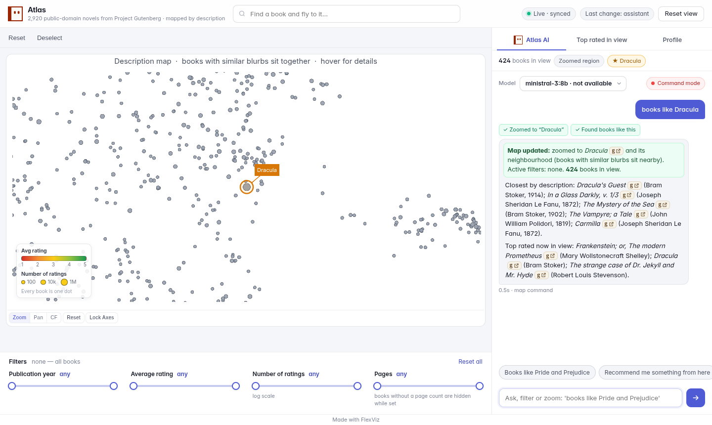

# Atlas

**A map of your books, arranged by what they are about, that you explore together with an AI librarian.**

Every book is a dot; books with similar descriptions sit close together. Zoom, filter by year, rating, popularity or length,
click a dot to open the book's page, or just ask *Atlas AI*: "books like Dracula", "only after 1990", "zoom to science
fiction", "recommend me something from here". You and Atlas AI drive **one shared view**, so whatever it does
happens on your screen, and it can see what you're looking at.



## Quickstart

```sh
pipx install --pip-args=--pre git+https://github.com/cedrichelewaut/atlas    # or: uv tool install --prerelease=allow git+https://github.com/cedrichelewaut/atlas
atlas demo                                                                    # opens the bundled sample at http://127.0.0.1:8010
```

Then your own books:

```sh
atlas import goodreads_library_export.csv && atlas serve
```

One-line installer (checks for Python, installs with uv or pipx, tells you about Ollama):
`curl -fsSL https://raw.githubusercontent.com/cedrichelewaut/atlas/main/install.sh | sh`

Docker: `docker build -t atlas . && docker run -p 8010:8010 atlas`

`--pre` is needed because Atlas depends on [FlexViz](https://flexviz.tech) `0.1.0b5`, which is a beta on PyPI.

## Importing your books

`atlas import <file>` reads:

| Format | Notes |
|---|---|
| **Goodreads export** (`goodreads_library_export.csv`) | Goodreads → My Books → Import and export → Export library. Uses the community average rating, page count, year, shelves; links go to the Goodreads book page. The export has no descriptions, so books are placed by title, author and shelves (less precise than descriptions). |
| **CSV / TSV** (`,` `;` or tab) | Column names are matched flexibly: `title` (Book Title, name), `author` (writer, authors), `year` (first published, publication_year), `description` (blurb, summary, synopsis), `rating` (average_rating, stars; 0-10/0-100 rescaled), `ratings_count` (num_ratings, votes, popularity, downloads), `pages`, `url`, `tags` (genres, subjects, shelves). Override with `--map description=MyColumn`. |
| **JSON / JSON Lines / Parquet** | A list of objects (or `{"books": [...]}`) with the same field names. |
| **Hugging Face dataset** | `atlas import --hf user/dataset [--hf-file data.parquet]` (`pipx inject atlas-books huggingface_hub`; uses `HF_TOKEN` for private datasets you own). |

What happens: descriptions are embedded **locally** with `all-MiniLM-L6-v2` (fastembed/ONNX, no GPU, nothing leaves your
machine), UMAP lays them out in 2D, and the result is written
to `~/.atlas/datasets/<name>/`. It scales from ~50 to ~500k books: 3k books take about a minute on a laptop CPU; above
150k books UMAP is fitted on a sample and the rest is projected. `atlas list` / `atlas use <name>` switch datasets;
`ATLAS_HOME` moves everything.

## Atlas AI (optional LLM)

Atlas AI always works in **rules mode**: a deterministic parser for filters, zoom, "books like X", authors, topics,
top rated and the recommendation wizard. With [Ollama](https://ollama.com) running locally (`ollama pull ministral-3:8b`)
it becomes a tool-calling LLM agent; the **model dropdown** lists your local models, or connect any OpenAI-compatible
endpoint (base URL + key; the key stays on your machine in `~/.atlas/librarian_model.json`, mode 0600, and is never sent
back to the browser).

## Architecture

```
browser ── FlexViz dashboard (iframe) ──┐      one shared FlexViz state (zoom + selections)
   │  WebGL dot layer, sliders, panels   │◄──── SSE "apply" patches ───┐
   └── POST /api/browser_state ──────────┘                             │
                                                                       │
FastAPI (atlas_books.app) ── state mirror M ── tools: set_view, set_filters, focus_book, zoom_to_topic,
   │                                          zoom_to_author, top_rated_in_view, similar_books, recommend_* ...
   ├── Atlas AI: rules parser (librarian.py) → optional LLM (Ollama / OpenAI-compatible) calling the same tools
   ├── embeddings index (int8 MiniLM vectors, numpy or faiss) for "similar books"
   └── data: ~/.atlas/datasets/<name>/{books,extra}.parquet, vecs_i8.npy, meta.json   ← atlas import
```

The human and the agent never have separate views: the agent changes the FlexViz state through the same tools an
external agent could call (`GET /api/tools`, `POST /api/tools/<name>`), the browser applies the patch, and acknowledges
it, so the agent's answer is about what you actually see.

## Data, licence and attribution

- Code: **MIT** (see `LICENSE`). FlexViz is Apache-2.0 and installed from PyPI, not vendored.
- The bundled sample is 2,920 public-domain novels from the **Project Gutenberg** catalog (summaries, subjects,
  download counts). It has no ratings, so "top rated" falls back to most downloaded.
- **No Goodreads data ships with Atlas.** The prototype was built on the UCSD Goodreads research dataset, which is
  licensed for academic, non-commercial use; nothing from it is in this repo. Bring your own export instead.
- Full notices: [`NOTICE.md`](NOTICE.md). Ideas for what's next: [`docs/ROADMAP.md`](docs/ROADMAP.md).
