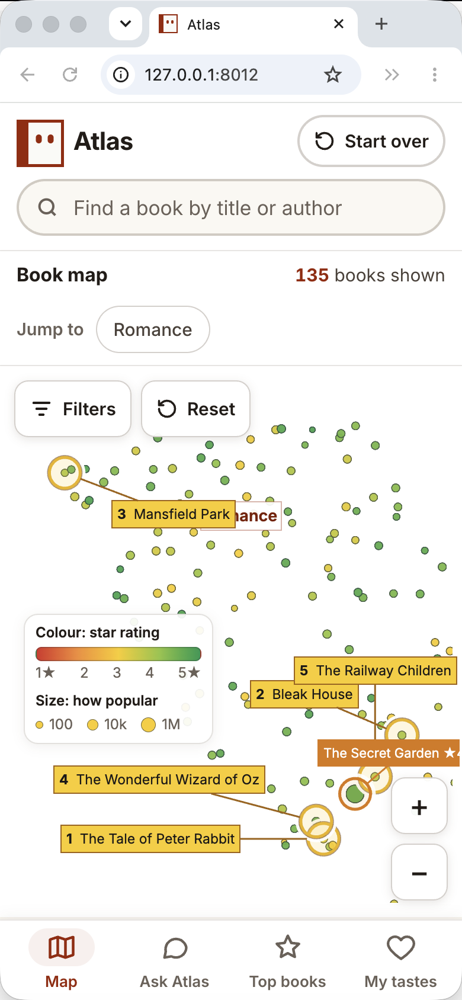

# Atlas

[](https://github.com/cedrichelewaut/atlas/actions/workflows/ci.yml)
[](https://pypi.org/project/atlas-books/)
[](https://pypi.org/project/atlas-books/)
[](LICENSE)

**A map of your books, arranged by what they are about, that you explore together with an AI librarian.**

Every book is a dot; books with similar descriptions sit close together. Zoom, filter by year, rating, popularity or length,
click a dot to open the book's page, or just ask *Atlas AI*: "books like Dracula", "only after 1990", "zoom to science
fiction", "recommend me something from here". You and Atlas AI drive **one shared view**, so whatever it does
happens on your screen, and it can see what you're looking at.


On a phone, Atlas opens straight on the map; the bottom tab bar switches to *Ask Atlas*:



## Contents

- [Quickstart](#quickstart)
- [Importing your books](#importing-your-books)
- [Atlas AI (optional LLM)](#atlas-ai-optional-llm)
- [Architecture](#architecture)
- [Development](#development)
- [Data, licence and attribution](#data-licence-and-attribution)
- [Contributing](CONTRIBUTING.md) · [Security policy](SECURITY.md) · [Docs](docs/README.md)

## Quickstart

```sh
pipx install --pip-args=--pre git+https://github.com/cedrichelewaut/atlas    # or: uv tool install --prerelease=allow git+https://github.com/cedrichelewaut/atlas
atlas import goodreads_library_export.csv && atlas serve                      # your books at http://127.0.0.1:8010
```

One-line installer (checks for Python, installs with uv or pipx, tells you about Ollama):
`curl -fsSL https://raw.githubusercontent.com/cedrichelewaut/atlas/main/install.sh | sh`

Docker: `docker build -t atlas . && docker run -p 8010:8010 atlas`

`--pre` is needed because Atlas depends on [FlexViz](https://flexviz.tech) `0.1.0b5`, which is a beta on PyPI.

**What to expect:** the install pulls about **900 MB** of dependencies (UMAP/numba, SciPy, ONNX Runtime) and takes
under a minute with uv. The first `atlas import` downloads the ~65 MB
`bge-small-en-v1.5` embedding model into `~/.atlas/models/` (once; `FASTEMBED_CACHE_PATH` moves it). If port 8010 is
taken, Atlas picks the next free port and says so.

## Importing your books

`atlas import <file>` reads:

| Format | Notes |
|---|---|
| **Goodreads export** (`goodreads_library_export.csv`) | Goodreads → My Books → Import and export → Export library. Uses the community average rating, page count, year, shelves; links go to the Goodreads book page. The export has no descriptions, so books are placed by title, author and shelves (less precise than descriptions). |
| **CSV / TSV** (`,` `;` or tab) | Column names are matched flexibly: `title` (Book Title, name), `author` (writer, authors), `year` (first published, publication_year), `description` (blurb, summary, synopsis), `rating` (average_rating, stars; 0-10/0-100 rescaled), `ratings_count` (num_ratings, votes, popularity, downloads), `pages`, `url`, `tags` (genres, subjects, shelves). Override with `--map description=MyColumn`. |
| **JSON / JSON Lines / Parquet** | A list of objects (or `{"books": [...]}`) with the same field names. |
| **Hugging Face dataset** | `atlas import --hf user/dataset [--hf-file data.parquet]` (`pipx inject atlas-books huggingface_hub`; uses `HF_TOKEN` for private datasets you own). |

What happens: each book becomes one text (title + tags/shelves + the description with marketing fluff stripped: praise
quotes, "New York Times bestselling", "from the author of", award and edition notes, "gripping"/"unforgettable"; library
shelves such as to-read or owned are dropped), which is embedded **locally** with `BAAI/bge-small-en-v1.5` (fastembed/ONNX,
up to 512 tokens, no GPU, nothing leaves your machine; `ATLAS_EMBED_MODEL` picks another fastembed model), UMAP lays the
vectors out in 2D, and the result is written
to `~/.atlas/datasets/<name>/`. It scales from ~50 to ~500k books: 3k books take about a minute on a laptop CPU; above
150k books UMAP is fitted on a sample and the rest is projected. `atlas list` / `atlas use <name>` switch datasets;
`ATLAS_HOME` moves everything.

## Atlas AI (optional LLM)

Atlas AI always works in **rules mode**: a deterministic parser for filters, zoom, "books like X", authors, topics,
top rated and the recommendation wizard. With [Ollama](https://ollama.com) running locally (`ollama pull ministral-3:8b`)
it becomes a tool-calling LLM agent; the **model dropdown** lists your local models, or connect any OpenAI-compatible
endpoint (base URL + key; the key stays on your machine in `~/.atlas/librarian_model.json`, mode 0600, and is never sent
back to the browser).

## Architecture

```
src/atlas_books/   cli.py · build.py · paths.py · store.py · state.py · routes.py · tools.py
                 librarian.py · agent.py · rec.py · providers.py · security.py · textprep.py · web/
tests/           pytest suite (conftest serves the small fixture dataset tests/fixtures/testdata)
docs/            ARCHITECTURE.md · AGENT_GUIDE.md · ROADMAP.md · adr/
```

```
browser ── FlexViz dashboard (iframe) ──┐      one shared FlexViz state (zoom + selections)
   │  WebGL dot layer, sliders, panels   │◄──── SSE "apply" patches ───┐
   └── POST /api/browser_state ──────────┘                             │
                                                                       │
FastAPI (atlas_books.app) ── state mirror M ── tools: set_view, set_filters, focus_book, zoom_to_topic,
   │                                          zoom_to_author, top_rated_in_view, similar_books, recommend_* ...
   ├── Atlas AI: rules parser (librarian.py) → optional LLM (Ollama / OpenAI-compatible) calling the same tools
   ├── embeddings index (int8 bge-small vectors, numpy or faiss) for "similar books"
   └── data: ~/.atlas/datasets/<name>/{books,extra}.parquet, vecs_i8.npy, meta.json   ← atlas import
```

The human and the agent never have separate views: the agent changes the FlexViz state through the same tools an
external agent could call (`GET /api/tools`, `POST /api/tools/<name>`), the browser applies the patch, and acknowledges
it, so the agent's answer is about what you actually see.

Highlights are part of that shared state too: a book you look up (search, "show me X") gets an orange ring and
title tag; every book Atlas AI recommends (chat answers or the final picks of the recommendation questions) gets a
yellow ring and a ranked tag. Recommendation highlights stay until the next recommendation or *Reset view*, the view
is framed so all picks are visible, the agent sees them in `view_state` (`highlights`, `summary.recommended`), and
clicking a ringed book still opens its link.

Full picture (Mermaid diagrams, chat-turn flow, import pipeline, on-disk layout, module map):
[`docs/ARCHITECTURE.md`](docs/ARCHITECTURE.md). The decisions behind the design: [`docs/adr/`](docs/adr/).

## Development

```sh
python3.12 -m venv .venv && . .venv/bin/activate
pip install --pre -e ".[dev]"              # --pre: FlexViz is a beta on PyPI
git config core.hooksPath .githooks        # pre-commit hook: ruff check + format --check
ruff check && ruff format                  # lint + format
pytest -q                                  # serves the fixture dataset on a free port; CI adds 3.10/3.11/3.13 + e2e
atlas serve                                # manual smoke test on your current dataset
```

See [CONTRIBUTING.md](CONTRIBUTING.md) for the workflow and [AGENTS.md](AGENTS.md) for the conventions (also loaded
automatically by Vibe and most coding agents).

## Data, licence and attribution

- Code: **MIT** (see `LICENSE`). FlexViz is Apache-2.0 and installed from PyPI, not vendored.
- **No Goodreads data ships with Atlas.** The prototype was built on the UCSD Goodreads research dataset, which is
  licensed for academic, non-commercial use; nothing from it is in this repo. Bring your own export instead.
- Full notices: [`NOTICE.md`](NOTICE.md). Docs index: [`docs/README.md`](docs/README.md) — architecture, agent guide,
  roadmap, ADRs.
