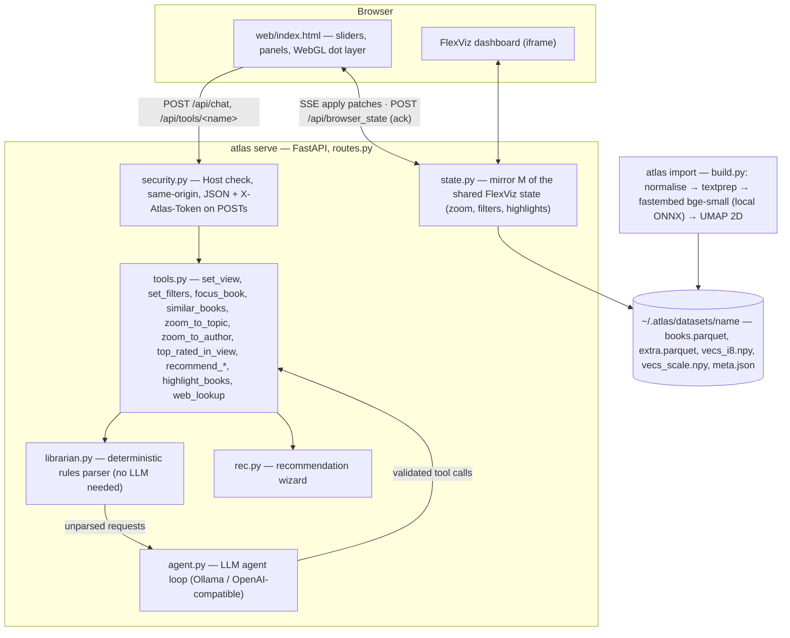

# Architecture

Atlas in one page. The short version: a browser UI and an AI agent drive **one shared map state**; anything the
agent does, the user sees.

## Context and containers



## The one idea: a single shared view

The human and Atlas AI never have separate views. The agent changes the FlexViz state through the same tools an
external agent could call (`GET /api/tools`, `POST /api/tools/<name>`); the server pushes the patch to every browser
over SSE; the browser applies it and POSTs an acknowledgement, so the agent's final answer is about what is actually
on screen. Highlights are part of the shared state: looked-up books get an orange ring, recommended books a yellow
ranked ring (see `state.py` / `tools.py:set_recs`).

## Chat turn, step by step

1. Browser POSTs `/api/chat` (JSON + `X-Atlas-Token`) with the message history.
2. `librarian.parse` tries the deterministic rules parser first — filters, zoom, "books like X", topics, authors,
   top rated, the recommendation wizard. Recognised requests run their tools directly (instant, exact, no LLM).
3. Otherwise `agent.run_agent_loop`: build messages with the CURRENT VIEW snapshot → one LLM step (Ollama local or
   any OpenAI-compatible endpoint) → tool calls are validated (`_guard`/`_valid`) and executed → each change is
   pushed to the browser as an SSE patch → up to 6 rounds → final answer (book mentions become clickable links).
4. `rec.py` runs the wizard the same way: ~50 candidates from the current view → 2–4 LLM-written multiple-choice
   questions (validated, with deterministic fallbacks) → top 3 picks, highlighted on the map.

## Import pipeline (`atlas import`)

`build.py`: read (Goodreads export CSV, any CSV/TSV with flexible column names, JSON/JSONL/Parquet, or a Hugging Face
dataset) → `normalise` (field mapping, `--map` overrides, rating rescaling) → `textprep` (strips marketing fluff,
review quotes and library shelves from descriptions) → embed locally with `BAAI/bge-small-en-v1.5`
(fastembed/ONNX, ≤512 tokens, length-sorted batches, no GPU) → quantise to int8 with a per-dimension scale → UMAP to
2D (fitted on a ≤150k sample above that size, the rest projected) → write the dataset directory. Scales from ~50 to
~500k books; 3k books take about a minute on a laptop CPU.

## Module map

| Module | Role |
|---|---|
| `cli.py` | `atlas` entry point: `demo` / `import` / `serve` / `list` / `use`, port picking, browser open |
| `build.py` | the import pipeline above |
| `paths.py` / `store.py` | `~/.atlas` layout, current-dataset pointer, dataset accessors |
| `state.py` | dataset + FlexViz dashboard spec + mirror `M` of the browser state (assembled at import; tests set `ATLAS_HOME` first) |
| `routes.py` | FastAPI routes: page, `/api/*`, SSE stream, binary map tiles |
| `tools.py` | the agent's toolset, also served over HTTP for external agents |
| `librarian.py` | deterministic rules parser |
| `agent.py` | LLM loop, system prompt built from the loaded dataset, trace hook |
| `rec.py` | recommendation wizard |
| `providers.py` | optional cloud "teacher" (Anthropic) for synthetic training data |
| `security.py` | ASGI guard: Host allowlist, same-origin, JSON-only + token on POSTs |
| `textprep.py` | description/tag cleaning before embedding |
| `web/` | single-page UI (`index.html` + Inter font) |

## On-disk layout

```
~/.atlas/
├── datasets/<name>/   books.parquet, extra.parquet, vecs_i8.npy, vecs_scale.npy, meta.json
├── models/            fastembed cache (bge-small-en-v1.5, ~65 MB, once)
├── current            pointer to the active dataset
├── librarian_model.json   LLM endpoint config, mode 0600
└── api_token          per-launch POST token, mode 0600
```

`ATLAS_HOME` moves everything; `ATLAS_DATA` points the server at one dataset dir directly.

## Security

See [SECURITY.md](../SECURITY.md) and `src/atlas_books/security.py`: loopback by default, per-launch token on all
POSTs, same-origin + Host checks, LLM base-URL validation, keys never sent to the browser.

## Testing

`tests/conftest.py` boots a live `atlas demo` server on a free port with an isolated `ATLAS_HOME` (no LLM: rules
mode only). `test_routes.py` exercises every GET route against it; `test_security.py`, `test_units.py`,
`test_smoke.py`, `test_finetune_tools.py` cover the guard, parser, textprep, normalisation and wizard. CI
(`.github/workflows/ci.yml`) runs ruff + the suite on Python 3.10/3.11/3.13 and an end-to-end CLI check.
